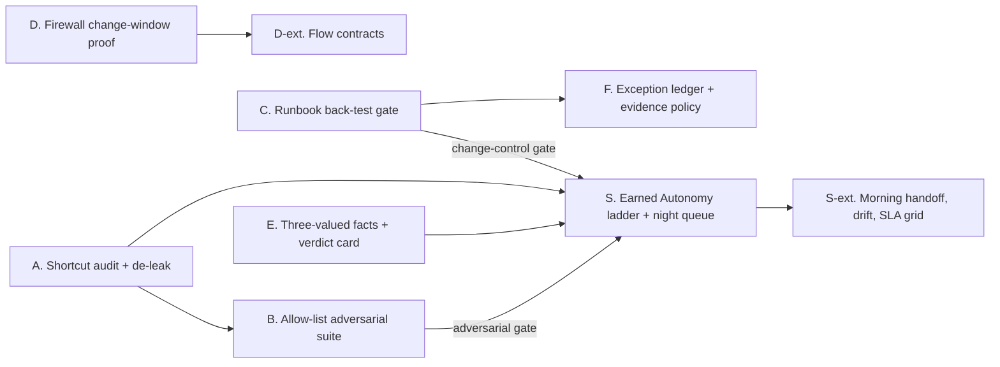

# Innovations plan: Earned Autonomy for the Night Shift

> **Status note.** Counts quoted in this plan (for example the number of alerts or rules) are snapshots of an
> in-progress build on 2026-10-10, used for planning only. They are not results. Results come only from
> `results/*.json`, written by scripts, and are rendered into the README by `scripts/render_readme.py`.

*Plan dated 2026-10-10, for the Compuquip interview on Thu 2026-10-15 with Kim Sullivan (COO). It was judged from three reviewer proposals and checked against the repo as it stands: 18 rule runbooks plus `_global.yaml`; the triage graph, policy, review queue and injection modules; firewall space/oracle/resolver with PAN-OS, FortiOS and Check Point parsers landing; 48 SYNTHETIC firewall change requests; no commits yet. **Tier 1** is built before the interview, about 18 build hours across 3 parallel agents. **Tier 2** comes after.*

---

## Signature story

Compuquip wants AI to do the reasoning at scale against live customer environments that carry service commitments. A COO does not ask "what is the F1 score?" She asks what the system is trusted to do at 3am, for which customer, how it earned that trust, and how the trust is taken away when it is wrong. The signature answer is **Earned Autonomy**. Every (customer, detection) pair starts in shadow mode and climbs a four-step ladder: shadow, then suggest, then daytime auto-close with full next-morning review, then overnight auto-close with sampled QA. It climbs only on analyst-verified evidence, and every step is gated:

- an exact one-sided Clopper-Pearson bound on the false-close rate;
- zero auto-closes in an adversarial suite built to look like the allow-list;
- a back-test showing that the current runbook version never moves a past attack toward close.

Any of three events demotes the pair automatically: one confirmed false close, a risky runbook edit, or a kill switch.

The supporting pieces make that evidence trustworthy:

- a **shortcut audit** proves the benchmark cannot be solved by reading timestamps;
- the **adversarial suite** attacks the allow-lists;
- the **back-test gate** treats tradecraft edits like code changes;
- the same "prove it before the window" discipline is applied to **firewall changes**.

The honest expected outcome on 104 alerts is that no rule has earned daytime or overnight autonomy. At most 8 benign alerts per rule exist in the whole corpus, and 59 or 299 verified clean closes are needed at the default targets. The system says so, and tells each rule exactly how many reviewed verdicts it still needs. That is the point: today the copilot reorders the night queue, and it has to earn the right to shrink it.

## Selected innovations

| # | Innovation | What it is | Headline metric (computed by code, written to results/) | Tier | Hours |
|---|---|---|---|---|---|
| S | **Earned Autonomy for the Night Shift** (SIGNATURE) | A ladder per (tenant, rule): L0 shadow, L1 suggest, L2 daytime auto-close, L3 overnight auto-close. Levels are computed from a hash-chained verdict ledger with exact binomial gates and automatic demotion. Includes the night-queue view. | Per rule: level, CP95 upper bound on the false-close rate, verdicts still needed for L2 and L3. Queue position of each malicious alert, baseline vs copilot. Alerts until demotion after an injected false-close campaign (SYNTHETIC stream). | 1 core, 2 ext | 5 + 5 |
| A | Shortcut audit and de-leak gate | Can a one-line rule on nuisance features pass my benchmark? Rebase the SYNTHETIC generator, and refuse headline numbers when the benchmark is leaky. | Leave-one-rule-out accuracy and AUROC of nuisance-feature stumps, before and after. Agent and baseline metrics on the v1 (leaky) and v2 (rebased) benchmarks. | 1 | 3 |
| B | Living-off-the-allow-list adversarial suite + safety properties | Mutation operators turn real attacks into allow-list look-alikes. Metamorphic, monotonicity and veto-only properties. A held-out benign regeneration. | Unsafe auto-closes per operator and arm (k/N with Wilson CI and CP upper bound). Property violations. Held-out vs in-sample benign close rate. Count of outcomes the LLM changed. | 1 | 4 |
| C | Runbook change back-test gate + close-path inventory | A pre-merge blast-radius report for knowledge edits that blocks any flip toward close on a malicious alert. Plus a static inventory of the facts each close path rests on. | Flips by direction per edit; bad edits blocked out of total; safe edits wrongly blocked; close paths without binary or activity attestation. | 1 | 2 |
| D | Firewall change-window proof | Exact pre/post traffic delta under first-match semantics: intent achieved / ineffective / collateral / breaks existing / cannot prove. Witness flows, a proven rollback, Batfish differential and a grounded summary. | Detection per defect class against oracle-derived labels; false alarms on clean proposals; rollback exact-equivalence count; engine/oracle/Batfish agreement; p50/p95 ms per change. | 1 core, 2 ext | 4 + 4 |
| E | Know what you cannot see | Three-valued (Kleene) facts, telemetry-health facts and a verdict card (checked / could not check / would escalate if). Rationales may only cite facts. | False closes on SYNTHETIC telemetry-gap scenarios with two-valued vs three-valued logic; extra holds on gap-free data; unsupported-claim rate in LLM rationales. | 2 | 6 |
| F | Exception debt ledger + evidence policy for close paths | Tickets, suppressions and expiring firewall rules in one ledger, with breadth and expiry. Scoped-ticket facts. A validator that requires attested evidence on close paths. | Malicious alerts that a naive `change.covered -> close` criterion would auto-close vs the scoped policy; benign alerts that lose eligibility; expired firewall exceptions found vs planted (precision/recall). | 2 | 5 |

---

## Tier 1 build specs (before the interview)

Conventions for every item: offline unit tests use fixtures and fakes (CLAUDE.md). Real Ollama or Batfish runs are `@pytest.mark.integration`. Every number goes to `results/*.json` with `generated_at`, `benchmark_version` and seeds. Headline rates carry bootstrap 95% CIs (1,000 resamples, seed 42) plus a Wilson interval, and promotion gates use the exact one-sided CP upper bound. No new runtime dependencies: stumps, AUROC and CP are pure Python. Add a Makefile block `# ---- agent targets (innovations) ----` with `shortcut-audit`, `adversarial`, `runbook-impact`, `close-paths`, `change-proof`, `autonomy` and `innovations` (all of them).

### S. Earned Autonomy for the Night Shift (SIGNATURE), Tier 1 core, 5h

The core library starts on day 1 because it has no data dependency. The gates are wired in once B and C land.

**Components**
- `src/soccopilot/autonomy/stats.py`
  - `cp_upper(k, n, alpha=0.05)`: the one-sided exact Clopper-Pearson upper bound. It uses the closed form `1 - alpha**(1/n)` when k=0 and bisection on the binomial CDF (`math.comb`) otherwise, and returns 1.0 when n=0.
  - `verdicts_needed(k, n, target)`: the smallest additional m such that `cp_upper(k, n+m) <= target`, assuming no further errors. Returns `None` if m would exceed 100k.
  - Re-export it from `triage/evaluation.py`.
- `src/soccopilot/autonomy/ledger.py`: an append-only `results/autonomy/ledger.jsonl` with the same SHA-256 `prev` hash chain as `triage/review.py`, plus a `verify()` method.
  - Record fields: `tenant_id, rule_id, runbook_id, runbook_version, alert_id, proposed_action` (policy output before the autonomy gate), `final_action, level_at_decision, overnight, verdict, verdict_source` (`simulated_analyst_verdict` | `analyst_verdict`), `qa_sampled, ts, prev`.
  - Ingests (a) eval-harness outputs with simulated verdicts and (b) `ReviewQueue.export_ground_truth()` real-analyst records, with no code change between the two.
- `src/soccopilot/autonomy/ladder.py`: levels `L0_SHADOW, L1_SUGGEST, L2_DAY, L3_NIGHT`. It is event-sourced: replaying the ledger in time order produces the current level and a transition timeline.
  - **Evidence.** Verified closes n counts alerts where `proposed_action == close` and a verdict exists. Shadow proposals count, which is how evidence accrues with zero risk. False closes k counts those verified closes whose verdict is malicious.
  - **Gates**, all of which must pass for a level:
    1. Evidence: `cp_upper(k, n) <= target[level]` (L1 needs `n >= min_verified_for_L1` and k = 0 since the last demotion).
    2. Adversarial: no variant from B for this rule auto-closed under the current runbook version. It reads `results/adversarial_suite.json`; a missing file fails closed with "adversarial suite not run".
    3. Change control: C's impact report exists for the current runbook version and shows zero toward-close flips on malicious alerts. A missing report fails closed.
    4. Analyst ceiling: runbook and global `overnight.auto_close: false` caps the level at L2. YAML holds a *ceiling* only; a schema test rejects any `autonomy_level` key.
    5. Kill switch from config.
    6. L3 also needs at least `qa_cycles_for_L3` QA cycles at L2 with zero QA failures.
  - **Demotion.** Any record with `final_action == close` and verdict malicious moves (tenant, rule) to L0 at once and adds `needs_review` to the runbook in the report. A runbook version bump caps the level at L1 until `version_bump_min_new_closes` new verified closes arrive. Evidence carries over only if C reports zero toward-close flips. The kill switch also moves the pair to L0.
- `src/soccopilot/autonomy/gate.py`: `apply_autonomy(decision, level, overnight)`.
  - L0: close becomes hold, with `proposed_action=close` and the reason "shadow: not yet earned".
  - L1: close becomes hold with a pre-filled close verdict for one-click review.
  - L2: close is allowed by day; overnight it becomes hold.
  - L3: close is allowed.
  - It never touches hold or escalate. Call it once in the graph's `decide` node, after `policy.decide`, which stays pure.
- `src/soccopilot/autonomy/qa.py`: the morning QA sampler.
  - At L3 it draws `max(1, ceil(qa_rate * closes))` auto-closes per rule per night (seeded) into the ReviewQueue as audit items. At L2, every close goes to next-morning review.
  - A simulated analyst resolves items from ground truth with `analyst_noise` in {0, 0.02, 0.05}.
- `src/soccopilot/ops/night_queue.py`: maps alerts onto a SYNTHETIC 22:00-06:00 night, keeping first_seen order.
  - Baseline queue: Sigma level (critical > high > medium > low > informational), then FIFO.
  - Copilot queue: escalations sorted by (`incident.tactic_count`, `incident.distinct_rules`, level), then holds by level, then suggested closes (L0/L1). Closes permitted by L2 (day only) and L3 go to the audit list, not the queue.
  - **Position** = the 1-indexed count of items a human handles up to and including each malicious alert. It needs no assumptions about handling times.
  - Also report a clearly labelled **counterfactual "every rule at L3"**: positions, plus the malicious alerts that would have been auto-closed.
- `config/autonomy.yaml`: `alpha: 0.05, target: {L2: 0.05, L3: 0.01}, min_verified_for_L1: 5, qa_rate: 0.10, qa_cycles_for_L3: 1, version_bump_min_new_closes: 10, pooled_evidence_across_tenants: false, kill_switch: []`. The file header says these are policy parameters owned by operations, not tuned values.
- `scripts/autonomy_replay.py` builds the **SYNTHETIC mechanism stream**. Its purpose is to show the control loop, not safety rates.
  - Fresh draws from A's seedable benign generator (new seeds), passed through Sigma and enrichment and triaged in `runbooks_only` mode. No LLM, because of the CPU budget.
  - Dedupe by fact-sheet hash and report the duplicates dropped. Never resample the same alerts.
  - Interleave the dev-split attacks. At a fixed index, inject a campaign of B's masquerade variants for one rule.
  - Sweep analyst noise over {0, 2, 5}% and `qa_rate` over {5, 10, 25}%.
- Tenancy: in Tier 1 one SYNTHETIC tenant id (`larkspur`, the customer named in `topology.json`). Everything is keyed by (tenant, rule), so a second tenant is data, not code.
- Surface: `GET /autonomy` and a level badge on queue items if the API and UI have landed. Otherwise a static `results/autonomy_report.html`.

**Tests** (`tests/autonomy/`)
- CP test vectors: 0/8 gives 0.3123; 0/9 gives 0.2831; 0/41 gives 0.0705; 0/298 is above 0.01; 0/299 is at or below 0.01. Clean closes needed at k=0: 59 for 5%, 149 for 2%, 299 for 1%. The bound is monotone in n and k.
- One false close demotes to L0 within one event.
- A version bump caps the level at L1.
- The kill switch works.
- Missing B or C artifacts fail closed.
- `apply_autonomy` never increases autonomy, checked by exhaustive enumeration.
- The ledger hash chain detects edits.
- An analyst_verdict export ingests unchanged.
- Night-queue positions on a hand-built fixture.

**Metrics JSON**
- `results/autonomy_ledger.json`: `{benchmark_version, config_hash, tenants: {t: {rules: [{rule_id, runbook_id, runbook_version, agent_closes, verified_closes, false_closes, cp95_upper_false_close, level, ceiling, blocking_reasons, verdicts_needed: {L2, L3}}]}}, levels_histogram}`
- `results/night_queue.json`: `{split, benchmark_version, baseline: {malicious_positions, median, max, queue_items}, copilot: {...}, auto_closed, malicious_auto_closed, counterfactual_all_L3: {...}}`
- `results/autonomy_replay.json` (SYNTHETIC): `{seeds, stream: {alerts, distinct, duplicates_dropped, injected_campaign: {rule_id, start_index, variants}}, timeline: [{index, rule_id, from, to, reason, alert_id}], by_noise: {...}, by_qa_rate: {rate: {false_closes_before_demotion, alerts_until_demotion, qa_items_per_night}}}`

**Docs:** `docs/autonomy.md` covers the mermaid state diagram, the gate list, the verdicts-needed math table (arithmetic, labelled as such), parameter ownership, and what the replay shows and does not show.

**Cut line:** first the noise and QA-rate sweeps, then the HTML report. Keep the ledger, the ladder, the demotion demo and the night queue.

### A. Shortcut audit and de-leak gate, Tier 1, 3h (build first; it changes every number)

**Pre-registered probe.** These numbers came from a read-only check on 2026-10-10 and must be reproduced by the script before anyone cites them:
- first_seen year separates 104/104 alerts (benign all 2023; malicious 2020 or 2022);
- `event_count > 1` agrees with the label on 99/104;
- 59 benign alerts come from users who are absent from every malicious alert;
- 146 of 216 SYNTHETIC benign events carry process_id 4321;
- 8 benign events carry an all-zero imphash;
- `variant_of` and `injection_payload_id` are null on all 104 alerts.

**Components**
- `src/soccopilot/benchmark/shortcut_audit.py` and `scripts/shortcut_audit.py`.
  - **Gated nuisance features:** year, month, weekday, hour; process_id (raw and "constant" flag); hash format (all-zero, length, entropy bucket); presence of dataset-id-like tokens.
  - **Contested features**, reported but not gated: `event_count`, user, host, `rule_level`. Bursts and approved service accounts can be real signal, so erasing them would be its own bias.
  - Classifiers: single-feature stumps (categorical majority per value, or best numeric threshold) and a depth-2 tree over the gated set. Validation is leave-one-rule-out CV. Report accuracy and AUROC (rank-based) against the majority baseline.
- Gate `assert_benchmark_clean()`: the eval harness's headline writer refuses to run when any gated feature exceeds majority + 0.05 accuracy or AUROC 0.75 (both parameters). `--allow-leaky` stamps `benchmark_status: LEAKY`, and the README writer will not render that as a headline.
- Leak scanner: render every prompt and tool output (from traces or the prompt builder with FakeLLM) and match against `config/leak_patterns.yaml` (`SDWIN-`, `SYNTHETIC`, scenario ids, `dataset_label`, `verdict_source`, `ground_truth`). Structured TI verdict fields are allow-listed.
- Generator rebase in `context/benign.py` and `scripts/make_benign_events.py`, with new flags `--seed --host-pool --path-pool` that B uses for held-out draws:
  1. timestamps re-dated into the OTRF recordings' calendar days and time-of-day distribution;
  2. PIDs drawn per process from the OTRF PID range, consistent within a process tree;
  3. a consistent seeded random SHA-256, MD5 and imphash per binary, with TI entries updated so approved binaries keep their intended verdict;
  4. a "concurrent" flavour: k benign scenarios placed on an OTRF attack host inside its recording window.

  Allow-listed accounts are left unchanged because they are decision-relevant.
- Freeze v1 before regenerating: copy to `data/processed/v1/` (gitignored). The eval runs both `v1-leaky` and `v2-rebased`.
- `docs/ground_truth_policy.md`:
  - The ~2.4-year "authorized purple-team" ticket CHG-1005 (WORKSTATION5, PEDRO-COMPUTER, MORDORDC; 2020-08-05 to 2022-12-31) does **not** relabel OTRF attacks. They stay malicious, because an MSSP still notifies the customer.
  - Concurrent-flavour alerts are benign at alert level and escalate at incident level, and are scored separately.
  - Variants inherit the label of their original.

**Tests:** a fixture where year separates fails the gate, and the shuffled version passes. LORO folds never contain the held-out rule. AUROC matches known values. The scanner flags `SDWIN-` and allows TI verdict fields. The rebased generator is deterministic per seed, has no PID on more than 10% of events, no all-zero hashes, and all timestamps inside recording days.

**Metrics JSON**
- `results/shortcut_audit.v1.json` and `.v2.json`: `{benchmark_version, n_alerts, majority_baseline_acc, gated: {feature: {loro_acc, auroc}}, contested: {...}, depth2_tree: {loro_acc, auroc, features_used}, gate: {acc_margin, auroc_max, passed}, leak_scanner: {prompts_scanned, tool_outputs_scanned, hits}}`
- `results/benchmark_comparison.json`: `{v1: {arm: metrics}, v2: {...}, delta}`

**Docs:** `docs/benchmark_audit.md`.

**Risk:** re-dating changes correlation and history facts, and the concurrent flavour escalates some benign alerts (which is realistic). Regenerate **once**, by Sunday midday, announce it to the triage and eval agents, and make no data changes after Monday noon.

### B. Living-off-the-allow-list adversarial suite + safety properties, Tier 1, 4h

**Static basis** (C's inventory must reproduce it):
- Close criteria across the 18 rule runbooks rest on image, parent or command-line text plus CMDB role or directory account type.
- None references `process.sha256`/`md5` or any `change.*` fact.
- RB-LSASS-ACCESS closes on `process.source_image` equal to the approved backup-agent path plus `host.role == backup_server`, and global `ti_clean` accepts `unknown`.
- Prediction, **unverified until run:** an unknown binary at the approved path on a backup server passes the runbook close path.

**Components**
- `src/soccopilot/adversarial/operators.py`: operators over a malicious alert's matched events. Each variant is a copy tagged `["SYNTHETIC","ADVERSARIAL"]`, with dataset id `SYNTHETIC-ADV-<op>-*`, `variant_of` set and label malicious. The operators:
  - (a) `allowlisted_host`: re-host to a CMDB host whose role a runbook trusts;
  - (b) `masquerade_name`: an allow-listed binary name in a non-approved directory;
  - (c) `approved_path_unknown_hash`: the exact approved path with a fresh hash that has no TI record, combined with (a) where needed;
  - (d) `inside_change_window`: time shifted into an approved ticket covering host and user, e.g. CHG-1005;
  - (e) `allowlisted_account`;
  - (f) `split_burst`: optional, and the first to cut;
  - (g) `injection`: reuse `triage/injection.py` payloads in the command line, registry value and ticket text.

  Re-run the compiled Sigma rule after mutation, keep only variants that still fire, and count the drops per operator.
- Held-out benign: A's generator with a new seed and held-out host, path and user-name pools that were not used while the runbooks were written. Tag `SYNTHETIC-HELDOUT`.
- Metamorphic transforms: host case and FQDN vs short name; `domain\user` case vs UPN form; command-line whitespace and argument order where order does not matter; JSON field order.
- `scripts/run_adversarial.py`: arms `severity_only`, `runbooks_only` and `runbooks_llm` (plus `llm_only`, reported as a non-deployable baseline). Overnight mode is on, the LLM runs at temperature 0 with a disk cache, and the run is unattended overnight.
- Gap workflow: each unsafe close becomes a gap entry. The fix is a runbook edit (e.g. require `process.sha256` in an approved set) plus an embedded example that reproduces the variant at fact level. The fix goes through C's gate, and a re-run shows the gap closed under the new version.

**Properties** (pytest, seeded loops, offline)
- P1 regression: every fixed gap's example stays non-close.
- P2 invariance: the `runbooks_only` verdict is identical under every metamorphic transform. Zero violations are required; any violation is a normalization bug.
- P3 monotonicity: adding an escalate-trigger fact never gives a less severe action, with the order close < hold < escalate.
- P4 veto-only: exhaustive enumeration of `policy.decide` over runbook verdict x LLM verdict x confidence grid x parse_ok x citations x overnight. The final severity is always at least the runbook severity.

**Metrics JSON:** `results/adversarial_suite.json`: `{benchmark_version, runbook_versions, operators: {op: {generated, dropped_no_detection, kept, per_arm: {arm: {unsafe_auto_close, n, rate, wilson95, cp95_upper, bootstrap95}}}}, overall_per_arm, injection: {payloads, verdict_changes_per_arm}, metamorphic: {cases, invariance_violations}, monotonicity: {cases, violations}, veto_property: {cases, violations}, heldout_benign: {in_sample: {closes, n, rate, ci}, heldout: {...}}, llm_marginal: {outcomes_changed_vs_runbooks_only, vetoes_on_malicious, false_vetoes_on_benign}, gaps: [{operator, rule_id, alert_id, runbook_id, fixed_in_version}], caveats}`. The caveats state that variants are correlated rather than iid, so the bounds are optimistic.

**Docs:** `docs/adversarial_suite.md` (self-authored, so it tests known gaps rather than unknown ones).

**Cut line:** first (f), then the size of the held-out regeneration. Keep (c), (d) and (e); they are the subtle operators.

### C. Runbook change back-test gate + close-path inventory, Tier 1, 2h

**Components**
- `src/soccopilot/runbooks/impact.py` and `scripts/runbook_impact.py`, run as `make runbook-impact BASE=<git-ref|dir>`. A directory is supported because the repo has no commits yet.
  - Triage persists per-alert fact sheets to `results/triage/fact_sheets.jsonl` (dev, test and B variants); add this output if it is absent.
  - Re-evaluate the base and head runbook sets with `runbooks.evaluate.evaluate_runbook`. This is deterministic and uses no LLM.
- Per-alert diff `{from, to, direction: toward_close | toward_caution | same}`, plus a static diff: escalate triggers removed or changed, close criteria added or removed, allow-list values added.
- Decision:
  - **BLOCK** (exit 2) on any toward-close flip on a malicious-labelled alert, or any escalate trigger removed or weakened.
  - **SECOND_APPROVER** on toward-close flips on high or critical assets, or a rise in close-eligible coverage above a threshold.
  - A version bump and changelog entry are required (the validator already checks them).
  - Facts missing from stored history evaluate as missing (fails closed) and are counted as `facts_unavailable`.
- Reports: `results/runbook_impact/<runbook_id>__v<a>_v<b>.json` and `.md` (ready to paste into a PR). S consumes them.
- Seeded edit corpus in `tests/runbooks/edits/`:
  - bad: widen the LSASS allow-list to rundll32, delete an escalate trigger, flip `eq` to `ne`, drop the `host.role` criterion;
  - safe: tighten an allow-list, add a hold criterion, add an example.
- `scripts/close_path_inventory.py` writes `results/close_path_inventory.json`. For each close path it lists the facts used, with source class (endpoint_text, endpoint_metadata, binary_attestation, cmdb, directory, itsm, ti, history_incident), and the flags `has_binary_attestation` and `has_activity_attestation`.

**Tests:** every bad edit is blocked; safe edits pass; direction is classified correctly; both git-ref and directory inputs work; missing facts are counted.

**Metrics:** `results/runbook_impact/summary.json`: `{edits_evaluated, bad: {total, blocked}, safe: {total, wrongly_blocked}, per_edit: [...]}`. And `close_path_inventory.json`: `{runbooks, close_paths, paths_without_binary_attestation, paths_without_activity_attestation, per_path}`.

**Docs:** `docs/runbook_change_control.md`.

### D. Firewall change-window proof, Tier 1 core, 4h (independent track)

Assumes the base normalized model, resolver, the three parsers and CR validation have landed. Existing data: 48 SYNTHETIC CRs, 16 per device, each with structured `intent` and a category (valid_new, already_allowed, blocked_by_existing_deny, unsafe_internet_to_db, unknown_host, missing_port, scope_too_broad, any_service_or_any_any).

**Components**
- `src/soccopilot/firewall/change_proof.py`:
  - `CandidateChange`: rule operations (insert at a position / modify / delete) in normalized form, plus a vendor render via `synth/render.py`.
  - `allow_space(policy)`: the effective first-match permitted `Space` over exact rules. It also collects the touched rules with `exact=False`.
  - `delta(pre, post)` returns (added, removed) via `Space.subtract`.
  - `prove(intent, pre, post)` sets these flags:
    - `ineffective` when intent is not a subset of post_allow; it names the first-matching blocking rule and gives a witness via `Box.sample_point`;
    - `collateral` when added minus intent is non-empty; it gives the CIDR and port blocks via `Box.describe` and witnesses mapped to topology hosts, zones and roles;
    - `breaks_existing` when removed is non-empty, with witness flows;
    - `cannot_prove` when any touched rule has `exact=False` (FQDN, application-default, dynamic), listing the objects responsible;
    - otherwise `achieved`.
  - `rollback(change, pre)` generates the inverse operations. `equivalent(a, b)` holds when both differences are empty.
- `scripts/make_change_proposals.py` writes `data/firewall/change_proposals.jsonl` (SYNTHETIC). For each CR with a valid intent it emits one correct implementation plus these defect variants:
  - `below_existing_deny`
  - `widened_cidr`
  - `any_service`
  - `object_typo`
  - `wrong_zone` (zones resolved to subnets)
  - `modifies_existing_rule` (narrows a live rule)
  - `fqdn_object`

  Labels are derived by `oracle.py`, never by `change_proof`.
- Batfish differential, a real `@integration` run:
  - On day 1, record which SYNTHETIC formats Batfish parses, with parse warnings.
  - For parsed vendors, sample at most 20 points per Added, Removed and intent box, and compare the pre and post `testFilters` decisions with the engine.
  - Unparsed vendors are reported as `not_parsed`, never as agreement.
- Change-board summary from qwen2.5:3b (cached). A checker extracts IPs, CIDRs, ports and host names from the text. It rejects anything not in the proof sets and requires every collateral block to be mentioned. On rejection, a deterministic template is used.
- A one-page go/no-go per change at `results/change_proof/<ticket>.md`: decision, intent, delta table, witnesses, rollback status, cannot-prove objects, Batfish status.

**Tests:**
- Hand-built three-rule policies: below a deny gives ineffective with an in-intent witness; /24 instead of /32 gives collateral with a witness outside the intent; the rollback is equivalent; an FQDN object gives cannot_prove.
- 200 seeded random small policies where the engine delta equals the oracle delta.
- A Batfish test marked integration.

**Metrics:** `results/change_proof.json`: `{proposals, per_vendor: {v: {per_class: {class: {expected, detected, missed}}, clean: {n, false_alarms}}}, rollback: {checked, exact_equivalent}, cannot_prove: {count, objects_by_type}, oracle_agreement: {cases, agree}, batfish: {vendor: {parsed, parse_warnings, points, agree}}, latency_ms: {p50, p95, n, machine_note}, summaries: {generated, rejected_ungrounded, missing_collateral, template_fallbacks}}`.

**Docs:** `docs/firewall_change_proof.md`, with an explicit scope statement: no NAT, App-ID, User-ID, dynamic objects or device-pushed state; zones are modelled as subnets.

**Cut line:** first the Batfish differential (keep oracle agreement), then the LLM summary (keep the template).

---

## Tier 2 specs (after the interview)

**S-ext. Signature extensions, 5h**
1. **Drift demotion.** Compare the close-eligible rate per (tenant, rule) against a trailing window with an exact binomial test, and cap at L1 on drift.
2. **Morning Handoff** report and UI page. It lists what auto-closed (QA-sampled items flagged), what was held and why, and what was escalated. Each escalation carries a customer-facing note. A deterministic grounding check requires every host, user, hash, IP and timestamp in a note to appear in the evidence bundle, after normalizing case and `domain\user` forms. An ungrounded entity blocks the note. A completeness checklist covers host, user, time, technique, evidence and recommended action.
3. **SLA sensitivity grid.** A loop-based discrete-event simulation sweeps analyst count, handling time and a benign multiplier (fresh SYNTHETIC draws). It is shown only as labelled sensitivity.
4. **Second SYNTHETIC tenant** with colliding host and user names, the pooled-vs-per-tenant evidence parameter, and server-bound `tenant_id` in the tool registry. Tenant layering and the isolation red team stay a design until then.

Metrics: `results/morning_handoff.json` `{notes, ungrounded_entities, blocked_notes, checklist_complete}`, `results/sla_sensitivity.json` and drift fields in `autonomy_ledger.json`.

**E. Know what you cannot see, 6h**
- Add facts `telemetry.gap_minutes_window`, `telemetry.volume_ratio_vs_host_baseline` and `telemetry.audit_policy_changed` to FACT_CATALOG.
- Kleene evaluation in `runbooks/conditions.py`: a count over a window containing a gap longer than X minutes becomes UNKNOWN. Close criteria need TRUE, so UNKNOWN gives hold with the reason "could not verify".
- Verdict card API with four lists: checked (fact, value, event ids), not checked, could not check, and "would escalate if" (the escalate trigger that minimal fact changes would fire).
- LLM rationales may only cite fact ids. A checker rejects citations of missing facts or contradictions of fact values, and a rejection forces a hold.
- Data: SYNTHETIC gap scenarios made by truncating host events, plus the public OTRF auditpol recording SDWIN-220630130349 (T1562.002).
- Tests: truth tables, and every runbook example still passes.
- Metrics: `results/telemetry_gaps.json` `{gap_scenarios, false_closes_two_valued, false_closes_three_valued, extra_holds_gap_free, rationale_checks: {n, unsupported_claims, contradictions}}`.

**F. Exception debt ledger + evidence policy, 5h**
- `src/soccopilot/exceptions/ledger.py` unifies three sources:
  - ITSM change tickets;
  - close paths relying on allow-lists or tickets;
  - firewall rules with "remove after YYYY-MM-DD" comments (`_EXPIRY_COMMENT` in `firewall/synth/build.py`; e.g. the planted "TEMP access for data migration - remove after 2025-06-30").
- Each exception carries owner, scope, start, expiry, approver and source. Breadth = hosts x days x tactic breadth.
- New facts: `change.ticket_window_hours`, `change.ticket_breadth`, `change.ticket_expired` and `change.ticket_names_activity`.
- Policy: only narrow, time-boxed tickets that name the activity can support auto-close. Broad or long-lived ones can support hold at most.
- The validator warns, or errors by policy, when a close path lacks binary attestation or a system-of-record anchor, using C's source classes.
- Counterfactual: a naive `change.covered -> close` criterion vs the scoped policy, over the corpus plus B's operator-(d) variants. CHG-1005 is the planted case; its outcome is **unverified until run**.
- Metrics: `results/exception_ledger.json` `{exceptions, expired_relied_on, would_have_hidden: {exception: [alert_ids]}, naive_malicious_closed, scoped_malicious_closed, benign_lost_eligibility, firewall_expired: {planted, detected, precision, recall}, close_paths_failing_policy}`.

**D-ext. Customer flow contracts, 4h**
- Per-customer YAML with must-allow and must-deny flows and embedded examples, validated in the same no-code pattern as runbooks.
- Every proposal is checked against the contracts.
- A SYNTHETIC observed-flow log is used for breakage, and CMDB criticality gives the blast radius.
- Metrics: contract regressions detected per class, and false alarms.

---

## Tier 1 schedule (3 parallel agents, about 18h)

| When | Agent 1 (data/eval) | Agent 2 (knowledge/autonomy) | Agent 3 (firewall) |
|---|---|---|---|
| Sat 10-10 eve to Sun 10-11 | A: freeze v1, audit v1, rebase generator, regenerate once, announce | C on fixtures; S core library + unit tests | D core proof + oracle tests; Batfish parse check |
| Mon 10-12 | B operators + properties; LLM arm runs overnight (cached) | C on stored fact sheets + inventory; S wiring | D proposal corpus + Batfish differential |
| Tue 10-13 | B gap fixes through C; audit v2; benchmark comparison | S gates from B/C, night queue, SYNTHETIC replay | D summaries + go/no-go pages |
| Wed 10-14 (freeze by noon) | `make innovations`; README Results block generated from results/*.json; docs; rehearse the 5-minute demo; no new features after freeze | | |

**Demo, 5 minutes:**
1. Shortcut audit, before vs after.
2. Night queue and the autonomy table, then inject a false close and watch the demotion.
3. A bad runbook edit gets BLOCKED.
4. A firewall CR's go/no-go page, with a witness packet and the proven rollback.

---

## Honesty box

**Can claim, only once the code has written the number to results/*.json:**
- The benchmark was audited for shortcuts. Report the nuisance-feature accuracy and AUROC before and after, and the agent metrics on both benchmarks.
- k of N self-authored adversarial variants were auto-closed per arm, with Wilson/bootstrap CIs and a CP bound, stating that variants are correlated.
- Specific allow-list gaps were found and fixed, with the runbook version that fixed each.
- The veto-only, monotonicity and invariance properties hold over the enumerated or generated cases.
- Each rule's autonomy level, its exact CP bound and the number of verdicts it still needs, computed from **simulated** analyst verdicts. The ledger accepts real `analyst_verdict` records unchanged.
- Queue positions of malicious alerts on the SYNTHETIC night, baseline vs copilot.
- The control loop demoted within N alerts on a **SYNTHETIC** stream.
- Firewall proofs agree with the brute-force oracle on n cases and with Batfish on the points it parsed. Rollbacks are exactly equivalent on n of m.
- p50/p95 latency on this machine.
- Arithmetic facts (not results): at 0 errors a one-sided 95% bound needs 59, 149 and 299 clean closes for 5%, 2% and 1%; 0/8 bounds the rate at about 31% and 0/41 at about 7%.

**Cannot claim:**
- Real-world miss rates, or that any rule is safe at a real customer.
- Analyst hours saved, real SLA attainment, automation rates at Compuquip volumes, or days to promotion.
- Real analyst verdicts. All verdicts are dataset-derived or simulated.
- Robustness to real adversaries or "injection-proof". Say "resisted k/N payloads in our suite".
- Calibrated LLM confidence. qwen2.5:3b's self-reported confidence is not calibrated, and the LLM is veto-only.
- That Batfish is ground truth. It is an independent second implementation.
- Behaviour on real PAN-OS, FortiOS or Check Point devices, Panorama/SmartConsole, NAT, App-ID, User-ID or dynamic objects.
- That KQL ran anywhere. It was generated, not executed.
- Tenant isolation or compliance guarantees (none are built in Tier 1).
- That the benchmark is leak-free. Only the tested shortcuts were removed.
- That the SYNTHETIC benign:malicious ratio (about 4:1 in v1) resembles a real SOC.
- Any probe number in this plan before the scripts reproduce it.
